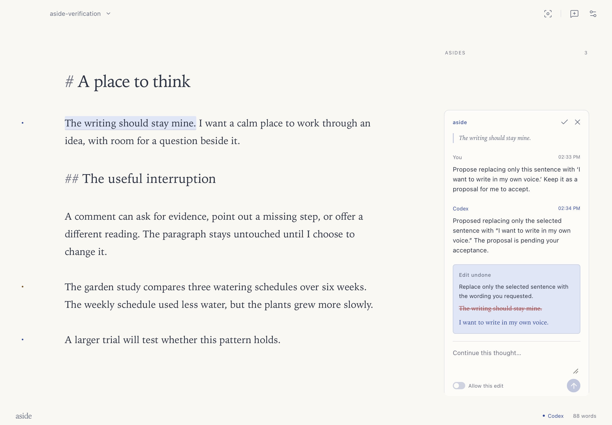
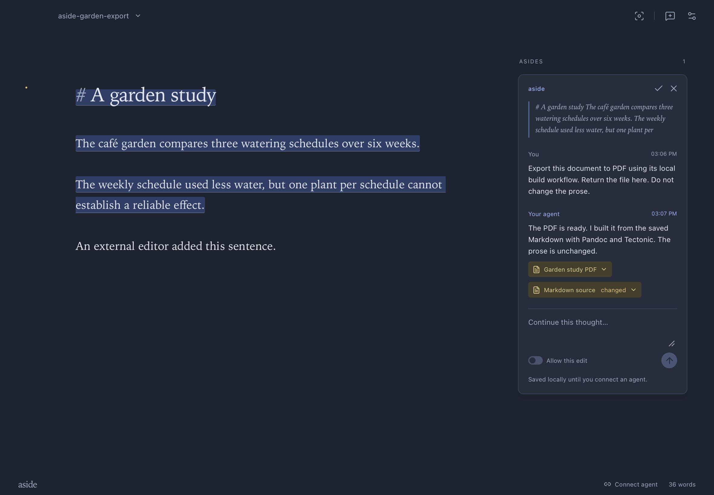

# Release verification

Version: 0.1.0. Build: `0.1.0+fab393049ddb`. Date: 2026-10-15.

The packaged Apple Silicon app ran on macOS 26.7.1. Verification used synthetic garden documents and a separate Codex session.

## Automated checks

| Check                            | Result                   |
| -------------------------------- | ------------------------ |
| TypeScript                       | Passed                   |
| Frontend behavior tests          | 9 passed                 |
| Rust storage tests               | 2 passed                 |
| Rust Clippy with warnings denied | Passed                   |
| Release bundle                   | Built                    |
| Bundle signature verification    | Passed, ad hoc signature |

The behavior tests cover anchor mapping, ambiguous relocation, Unicode boundaries, CRLF preservation, edit scope, revision conflicts, and undo provenance.

## Desktop workflows

Native interactions covered new, open, save, Save As, selection, paste, search, dead-key composition, undo, redo, menus, and focus mode. A longer manuscript scrolled through native Page Down input. Its text remained unchanged.

An untitled document recovered its exact text and identity after restart. Saved documents reopened with their annotations and provider provenance. External changes preserved the live buffer until explicit Reload. Save a copy retained both versions. A conflicting save failed.

The figure helper inserted a filename containing spaces, parentheses, and a hash sign. The Markdown reference encoded those characters. Table insertion and reading preview rendered a local figure and a standard Markdown table. Pandoc extensions remained in the source.

Caret, passage, and document requests persisted. Margin and Inline displayed the same threads. Deleting a passage exposed an unattached conversation. Undo restored its anchor. Ambiguous external duplication detached the anchors. Native Attach to selection restored the chosen anchor.

Source changes and missing files produced visible freshness markers. Source inspection and hashing ran outside the native UI thread.

## Agent workflows

A real existing Codex session received queued editor requests. It replied through MCP using context already present in that session. A proposed sentence replacement required native Accept. Undo restored the original prose and edit status. Redo restored the accepted edit.

A separate request allowed a direct insertion. The agent inserted only the requested text. Undo and redo preserved its provenance. Reusing the completed permission failed. Read-only requests, stale revisions, mismatched expected text, and edits outside the attached passage failed without changing prose.

The MCP connection survived app restarts. Request identities remained stable. Retrying an identical reply did not create a duplicate message. Invalid tools and parameters failed. The Unix socket used mode `0600` inside a `0700` directory and checked the connecting user.

The external export check saved Markdown through MCP, built a PDF with Pandoc and Tectonic, and attached it to an anchored reply. Text extraction and rendered inspection verified the PDF. The reply's Open file control opened that PDF in Preview. The build did not change the prose.

Claude channel support remains unverified on this machine. Its account policy prevented the live test. The user selected Codex for integration verification. The README states the external channel requirements.

## Visual checks

Computer use exercised native controls. aside MCP captured actual WebKit pixels with build, revision, viewport, selection, and capture identity. Screenshot review covered writing, conversations, proposals, sources, pending delivery, errors, detached anchors, settings, and empty documents.

Light and dark appearances were reviewed at 1180 by 820 and 700 by 480 logical pixels. Intermediate checks also used 900 by 700. Opening a visible margin thread preserved the text rectangle, selection, and scroll. Resizing retained the native selection highlight.

The final screenshots show the Ink and butter palette:

Illustrated captures use build `0.1.0+457013951ab3`. The final UI source is unchanged.

Final light capture: `95dbbb78-69f9-4d62-a73c-b83e8d4d0c6c`. Final dark capture: `047eaec8-46c2-43b7-b2dc-50e9a963ca7b`.

Interaction checks covered short reveal and feedback transitions. Typing has no animation. Reduced motion removed transitions. Background windows disabled motion. Native capture errors prevented reliable frame timing measurements.

## Delivery scope

The bundle includes the editor and MCP executable. Node.js, Rust, Pandoc, and Tectonic are not runtime dependencies of the editor. Export requires the document's external build tools.

This release uses local ad hoc signing. It has no Developer ID notarization. The delivered binary targets Apple Silicon. macOS 13 is the configured minimum; other macOS releases and Intel builds remain untested.

The repository contains fresh source, public dependencies, and synthetic examples. The privacy audit covers source, documentation, locks, assets, staged files, and initial Git history. The personal repository is private.
