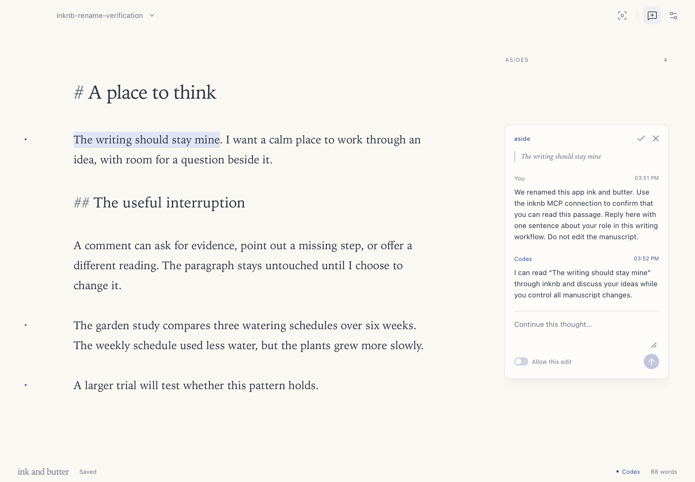
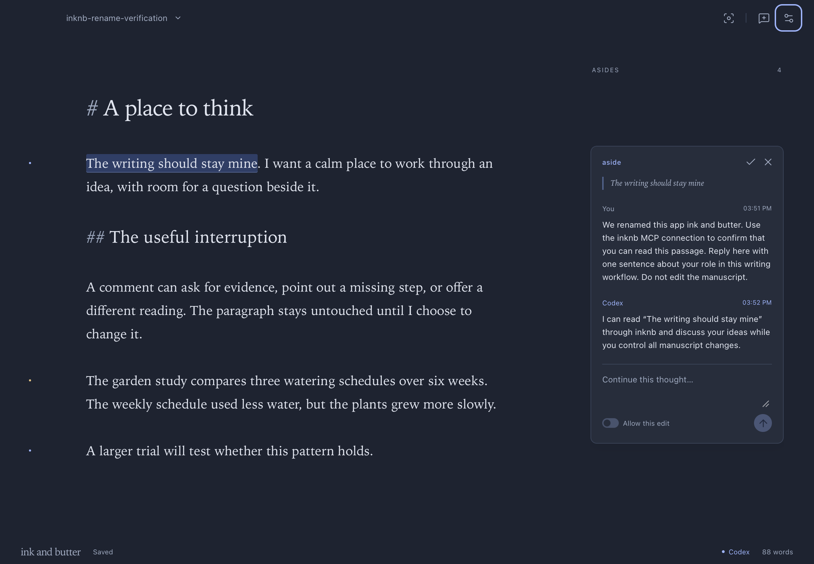

# Release verification

Version: 0.1.1. Build: `0.1.1+27cb7486dd2d`. Date: 2026-10-15.

This release names the app **ink and butter**. The repository, command, and MCP server use **inknb**. Margin conversations remain asides.

## Upgrade and integration

The packaged app ran on Apple Silicon with macOS 26.7.1. Existing preferences loaded unchanged. A document from version 0.1.0 retained its exact text, identity, and three conversations. The persistent application identity and `.aside.json` format remain stable.

The MCP initialization response identified `inknb` version `0.1.1` and listed all 13 tools. A real existing Codex session received a new request from the editor. It read the passage and replied through `inknb.conversation_reply`. The manuscript remained unchanged.

Save and restart preserved the new reply, prior conversations, and document identity. The original appearance preference was restored after visual checks.

## Checks

| Check                             | Result                                    |
| --------------------------------- | ----------------------------------------- |
| TypeScript and release build      | Passed                                    |
| Frontend behavior tests           | 9 passed                                  |
| Rust storage tests                | 2 passed                                  |
| Rust Clippy with warnings denied  | Passed                                    |
| Native app menu and About panel   | New name, icon, and version verified      |
| MCP configuration inside Settings | New server name and command path verified |
| Light and dark appearances        | Reviewed at 1180 by 820 and 700 by 480    |
| Local bundle signature            | Verified                                  |

The rename retains the document behavior verified in [version 0.1.0](release-0.1.0.md). No public dependency versions changed.

Light capture: `0e203486-8f16-4793-a199-5128b195acb4`. Dark capture: `b7ed0189-6d1a-41af-9c61-43ef16324d2b`.

## Delivery

The bundle contains the desktop app and `inknb`. MCP configuration uses the new executable path. The personal GitHub repository is `limiteinductive/inknb` and remains private.

This local Apple Silicon build uses ad hoc signing. It has no Developer ID notarization. Claude channel support remains unverified on this machine.
