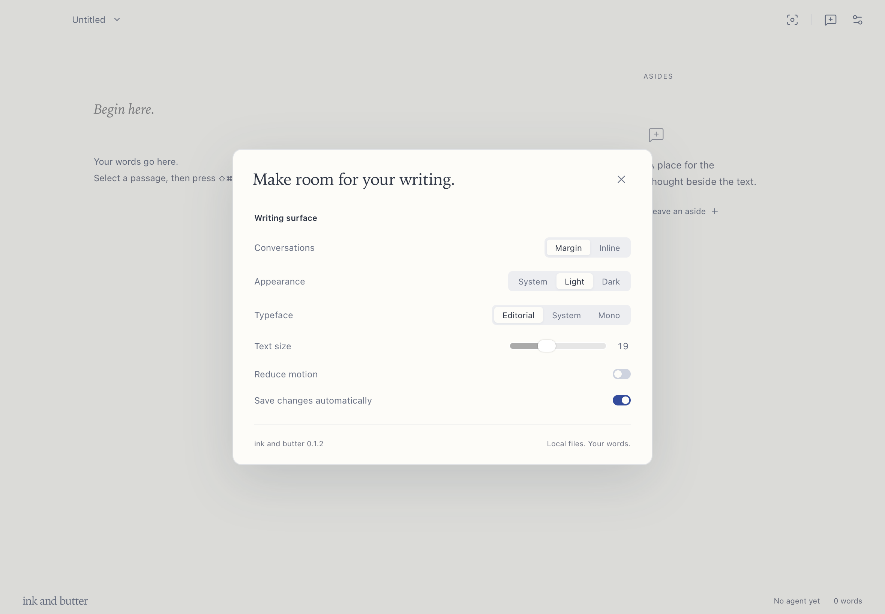
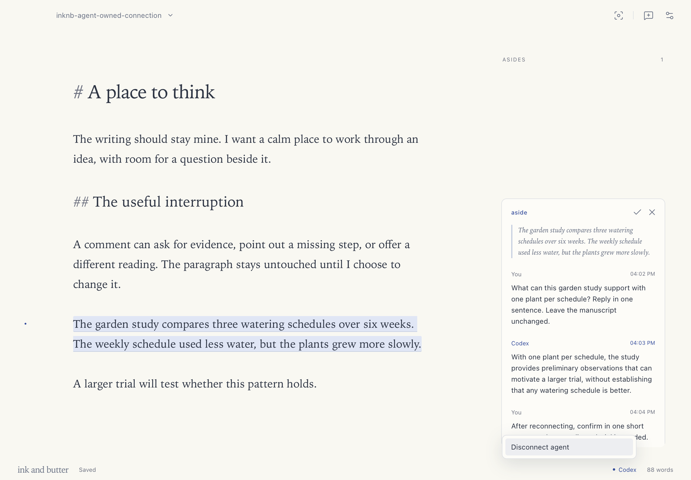

# Release verification

Version: 0.1.2. Build: `0.1.2+d77e3d7d9a92`. Date: 2026-10-15.

The external agent now handles connection setup. Settings contain writing preferences. The footer shows connection status and a Disconnect action.

## Connection workflow

A synthetic manuscript received an aside while no agent was connected. The request stayed pending with read permission.

An existing Codex session ran the packaged `inknb connect` command from its own shell. The initial sandbox blocked the local socket. The agent retried with its normal approval flow. The command registered that session's own identity.

Registration delivered the saved aside. Codex read the live manuscript and returned a reply through MCP. The manuscript stayed byte-identical. A queued notification after the reply caused no second reply.

Disconnect through the native app menu removed the document connection. A new aside stayed pending locally. The same Codex session rejoined and answered that request. The earlier reply remained unchanged.

Two further registrations preserved completed requests, delivery timestamps, and conversation messages. Save and restart preserved the document identity, prose, connection, request permissions, replies, and provenance.

The final package also passed registration against the saved document. Completed requests and prose remained unchanged.

## Checks

| Check                            | Result                                               |
| -------------------------------- | ---------------------------------------------------- |
| TypeScript and release build     | Passed                                               |
| Frontend behavior tests          | 12 passed                                            |
| Rust storage tests               | 2 passed                                             |
| Rust Clippy with warnings denied | Passed                                               |
| Packaged MCP server              | Version 0.1.2, 14 tools                              |
| Invalid document identity        | Rejected without registration                        |
| Invalid Codex session identity   | Rejected without registration                        |
| CLI without a current session    | Rejected with agent-facing guidance                  |
| Settings                         | Native controls contain writing preferences only     |
| Connection menu                  | Native Disconnect action verified                    |
| Compact settings                 | Light and dark reviewed at 700 by 480                |
| Normal window                    | Settings and connection menu reviewed at 1180 by 820 |
| Installed and extracted bundles  | Local signatures and binary equality verified        |

The release retains the document behavior verified in [version 0.1.0](release-0.1.0.md) and the naming upgrade in [version 0.1.1](release-0.1.1.md). Public dependency versions remain unchanged.

Settings capture: `36b7c93a-9695-4472-95aa-e03153741db7`. Menu capture: `f045cf1e-97f2-4cb7-9aaf-ac66835e48ca`.

## Delivery

The package contains the desktop app and CLI. Agents can use the CLI before configuring MCP. Persistent MCP setup remains in the external agent's environment.

This Apple Silicon build uses ad hoc signing. It has no Developer ID notarization. Claude channel support remains unverified on this machine.
