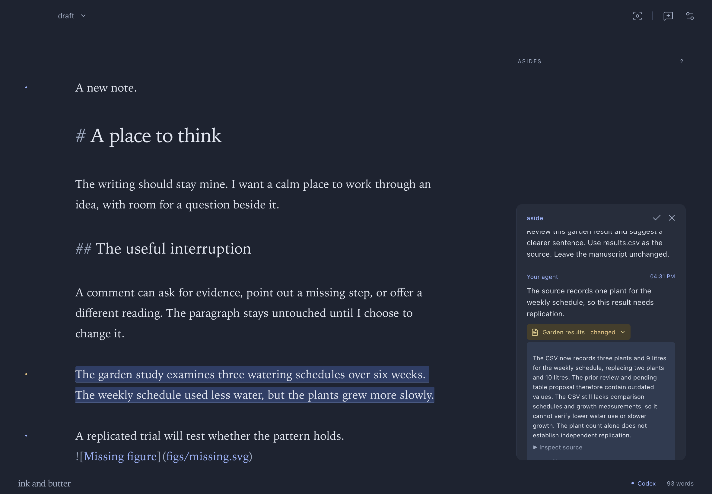
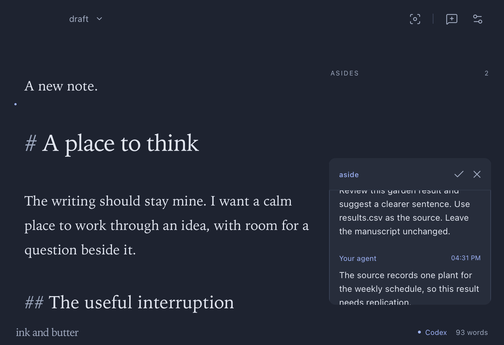

# Release verification

Version: 0.2.0. Build: `0.2.0+7d38569352c4`. Date: 2026-10-15.

Agents now receive source reviews, proposal refreshes, and anchor repairs through the existing request queue. Maintenance requests permit replies and proposals. They grant no direct prose edit permission.

## Live workflows

A real existing Codex session joined a synthetic manuscript through the packaged CLI. An unrelated insertion preserved a pending suggestion at its new position. Changing the suggested passage queued refresh work. Codex read the current text and returned a replacement proposal. Acceptance and Undo worked through the desktop app.

Two changes to a local CSV created separate fingerprint-scoped reviews. Codex read each file version and explained the new plant count and water use beside the affected paragraph. It identified missing comparison data and replication evidence. The prose stayed under human control.

Replacing a conclusion detached its discussion. Codex returned a candidate for the new conclusion. The native app showed that candidate for human confirmation. Confirmation reattached the discussion and completed its repair request.

Figure and table tools prepared pending insertions without changing prose. Maintenance work could not use direct edits. A document move preserved the Markdown, annotations, and local references, including an asset in a pending proposal.

An independent Node backend subscribed through `inknb hook`. It posted a missing-figure finding and resolved its own finding after the file became available. Its named checkpoint survived app restarts. A separate handler failed once, received the same event identity again, and acknowledged it after success.

## Checks

| Check                            | Result                                                            |
| -------------------------------- | ----------------------------------------------------------------- |
| TypeScript and release build     | Passed                                                            |
| Frontend behavior tests          | 17 passed                                                         |
| Rust storage and event tests     | 6 passed                                                          |
| Rust Clippy with warnings denied | Passed                                                            |
| Packaged MCP server              | Version 0.2.0, 26 tools                                           |
| Event replay                     | Stable IDs, duplicate rejection, durable checkpoints              |
| Delivery receipts                | Completed sends preserved; uncertain sends require reconciliation |
| Source review guards             | Newer fingerprints and generic reply bypass rejected              |
| Proposal refresh                 | Unrelated typing preserved; affected text requested refresh       |
| External annotations             | Read-only findings; human discussions protected                   |
| Document move                    | Markdown, sidecar, relative assets, and recovery verified         |

The interface and package checks below identify the final build. Earlier connection evidence remains in [version 0.1.2](release-0.1.2.md).

## Compatibility

Annotation format 2 reads format 1 sidecars. Earlier app releases cannot read the new maintenance requests. Keep the current app when using updated annotations.

The event journal stays in local application support data. It uses SQLite with full synchronization. The protocol uses the existing same-user Unix socket. It opens no TCP listener.

This Apple Silicon build uses ad hoc signing. It has no Developer ID notarization. Claude channel support remains unverified on this machine.

## Final package and interface

The installed build preserved the complete synthetic document across restart. The document identity, revision, path, text, and metadata matched exactly. The packaged MCP server exposed all 26 tools. An unsupported socket version returned an explicit error.

Native computer use exercised the conversation, source disclosure, scrolling, menus, and a new document. The sticky conversation heading retained Resolve and Close controls. Screenshots received visual inspection at 1180 by 820 and 700 by 480.

The final review used Dark appearance. Automatic approval review rejected a temporary Light appearance check. Dark stayed unchanged. The earlier light appearance review remains in version 0.1.2.

The extracted release archive passed local signature verification. Its desktop and CLI binaries matched the installed app. The personal GitHub repository remained private. The app was left on an empty document after the synthetic checks.

Capture: `6ae4f552-98a1-4a3d-a7f0-99e606221ba1`.

Capture: `f903b469-10e9-4419-8dd9-f0aa3f182e1b`.
