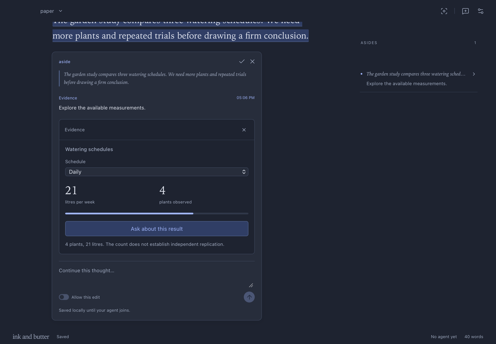
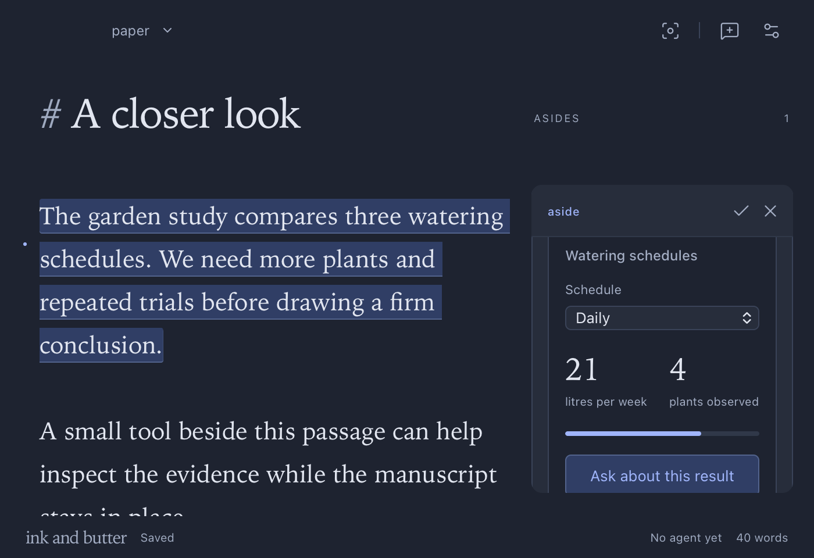
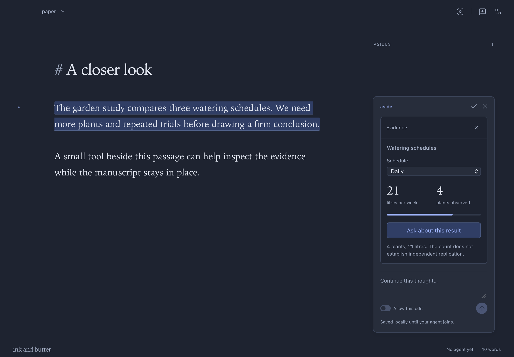
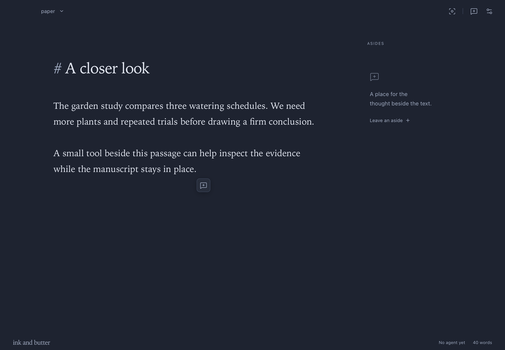
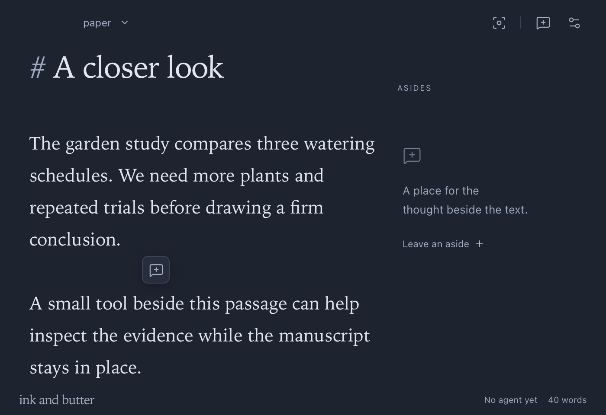

# Release verification

Version: 0.3.0. Build: `0.3.0+fb8580b3b8e9`. Date: 2026-10-15.

Agents can load custom interactive components and operate declared UI controls. Components attach to asides and retain their data and state. Code updates require no desktop rebuild.

## Live component workflow

A local evidence package loaded into a synthetic document. Native input selected a schedule and saved its state. Agent UI actions selected another schedule. A backend hook received the component event and returned an answer into the same card. The manuscript stayed unchanged.

A new package fingerprint replaced the live code. Data and selection survived. The desktop build identity stayed unchanged. A local module package also loaded relative JavaScript imports and used the runtime's ready promise.

A real existing Codex session read the component contract and registered the package through MCP. It selected Daily, requested a backend result, and inspected a rendered screenshot. The backend returned four plants and 21 litres. Codex verified that text, revision, permissions, and proposals stayed unchanged.

A source-frame probe could not read the parent document or access the native bridge. A reachable loopback server received no requests from a fetch attempt or remote navigation. The frame remained in standards mode.

An intentionally failing component showed a local error. Other components stayed ready. Replacing the failing code restored its card.

## Checks

| Check                                  | Result                                                                     |
| -------------------------------------- | -------------------------------------------------------------------------- |
| TypeScript and release build           | Passed                                                                     |
| Frontend behavior tests                | 19 passed                                                                  |
| Rust storage, event, and package tests | 7 passed                                                                   |
| Rust Clippy with warnings denied       | Passed                                                                     |
| MCP tools                              | Version 0.3.0, 33 tools                                                    |
| Package registration                   | Immutable capture; symbolic links rejected                                 |
| Component state                        | Saved, revision guarded, and preserved after code updates                  |
| Backend integration                    | Durable interaction event and visible response                             |
| Agent UI actions                       | Host navigation and component input verified                               |
| Human controls                         | Acceptance, permission grants, message submission, and resolution excluded |
| UI preconditions                       | Stale snapshots rejected                                                   |
| Isolation                              | Parent access, native bridge, network, and remote navigation blocked       |

Earlier automation evidence remains in [version 0.2.0](release-0.2.0.md). The final package and layout checks appear below.

## Compatibility

Annotation format 3 reads formats 1 and 2. Earlier app versions do not preserve component instances. Registered code remains in local application support data. Sidecars contain references and state.

The component guide is available through `protocol_info.componentGuide`. Agents keep build tools, dependencies, models, credentials, and backend processes in their external environment.

This Apple Silicon build uses ad hoc signing. It has no Developer ID notarization. Claude channel support remains unverified on this machine.

## Final package and interface

The final build repeated the real Codex interaction through MCP. It preserved manuscript text, hash, revision, permissions, proposals, and messages. Concurrent mount retries created one instance. Complete saved metadata matched after restart.

A failing frame emitted four timer events before its error. Its event count stayed at four after the host stopped the frame. Corrected code restored the instance. Agent actions also entered and left focus mode.

Native computer use checked the selector, settings, placement controls, and document menu. Margin and inline screenshots received visual inspection at 1180 by 820. The compact margin received inspection at 700 by 480. Dark appearance and the original writing preferences remained unchanged.

The extracted archive passed local signature verification. Its CLI and desktop binaries matched the installed app. The app was left on an empty document. No component frames or test backend processes remained open.

Capture: `06757cc7-8289-4209-b606-0f05e8e4b1d4`.

Capture: `70274550-9fd6-4dd7-be9e-875375869f52`.

Capture: `da173bc3-8cf1-4905-a955-5723e45dc87f`.

## Corner rendering, version 0.3.1

Build: `0.3.1+79e590f90b6a`. Date: 2026-10-15.

The conversation card retains its border while its contents scroll. The sticky header uses the card padding at each window width.

TypeScript, the release build, formatting, and all 19 existing frontend tests passed. Native screenshots received visual inspection at 1180 by 820 and 700 by 480. The checks covered both scroll endpoints and a short conversation. The original writing preferences remained unchanged.

Capture: `4a0c36db-ed2e-454e-9065-4a48f54a2239`. Compact capture: `58c0e0c4-465c-4b84-8da9-1b350fe65ff3`.

## Selection action, version 0.3.2

Build: `0.3.2+e0220bddab73`. Date: 2026-10-15.

A completed selection exposes a speech bubble action beside the text. Its icon matches the header. Activation preserves the selection and focuses the request box. Repeated activation also focuses an existing draft.

TypeScript, formatting, the release build, and all 19 existing frontend tests passed. Native computer use checked keyboard selection, selection clearing, and Escape. Local UI tools checked activation, selection offsets, repeated focus, and unchanged document data.

Screenshots received visual inspection at 1180 by 820 and 700 by 480. Wrapped selections use their full bounds for placement. A selection that fills the viewport keeps the action near its active end.

The final checks used a separate synthetic document. The original sample document, saved aside, and writing preferences remained intact. WebKit snapshots omit native selection paint. Live selection offsets provide the selection evidence.

Drafts currently use the live editor selection until submission. Fixed draft anchors and linked message references remain proposed changes.

Capture: `52ce393f-702d-4238-a489-88f23fa54de9`.

Capture: `4a7aa86a-c3ba-4963-a288-def7e3786976`. Large selection capture: `f7f86bb1-249c-428f-a7e1-1a6ed4b6cf73`.
