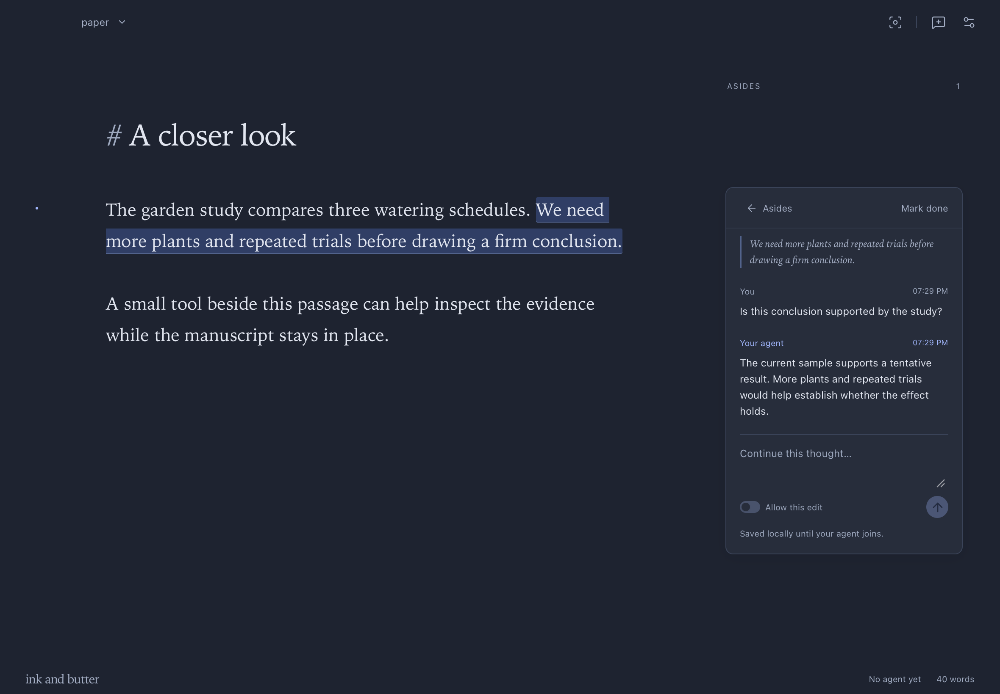
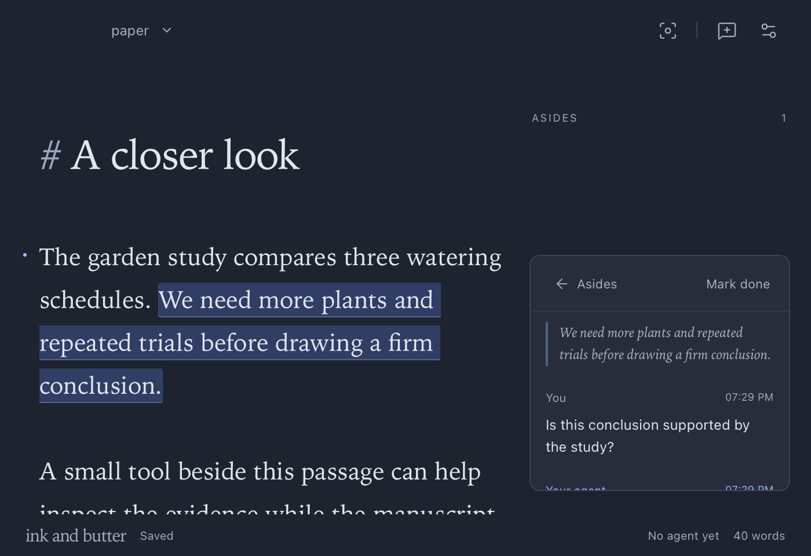
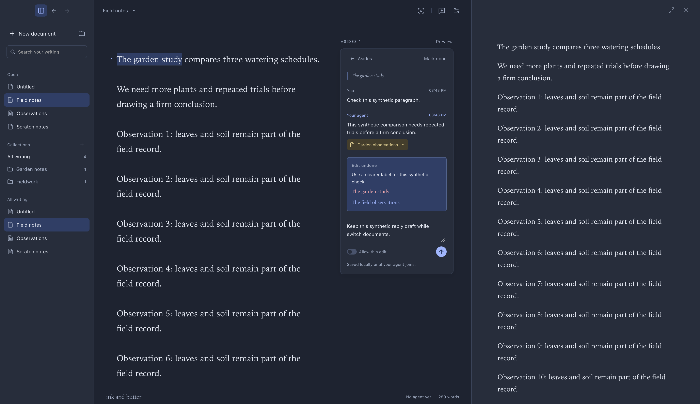
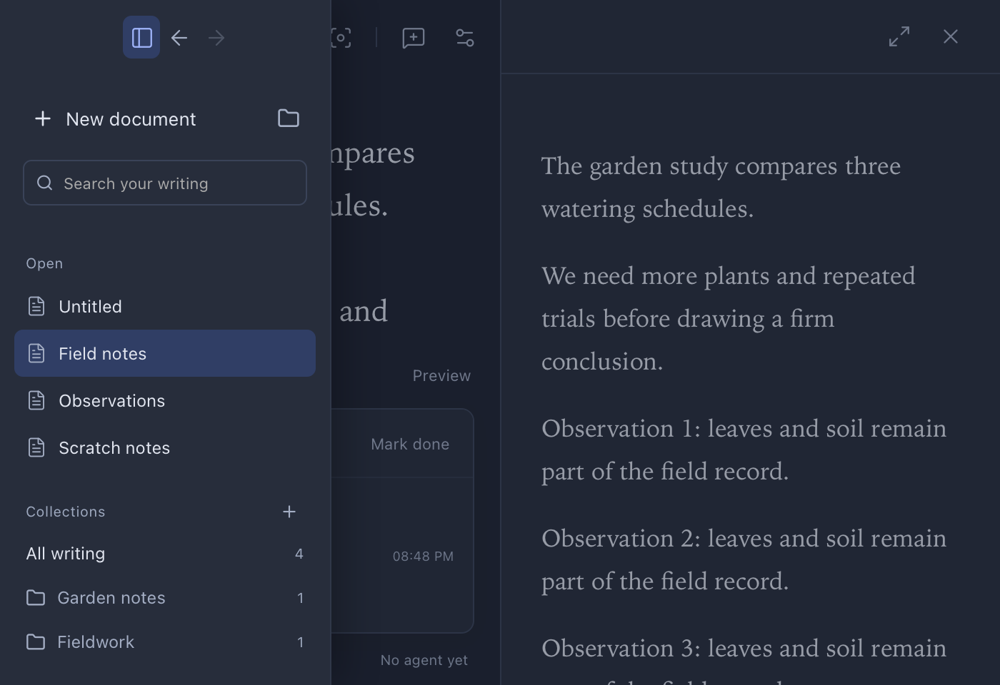
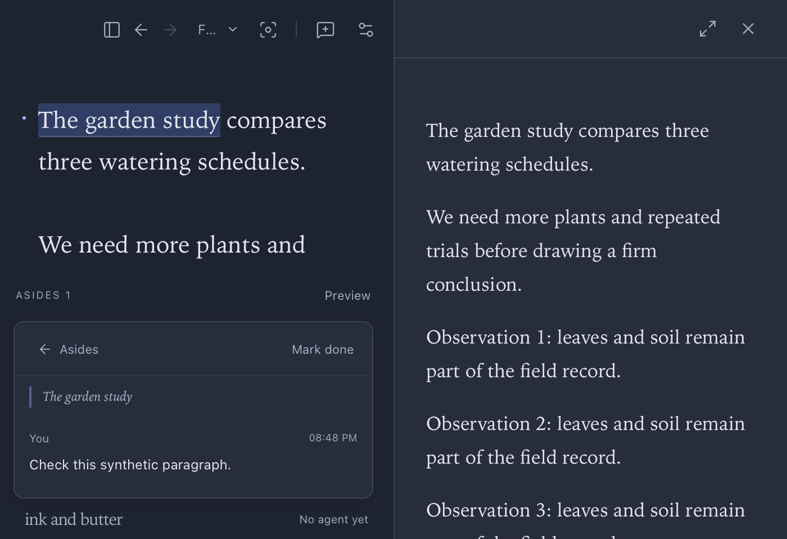

## Image paste, 2026-10-17

Build 0.5.1+29099c24c5ca adds image paste to the writer and aside composers. Existing TypeScript, 19 frontend checks, seven core checks, Clippy, formatting, production packaging, and signature verification passed. Native clipboard interaction, draft restart recovery, and detached preview paste remain pending installation approval.

## Source viewport correction and cleanup, 2026-10-17

Installed build: `0.5.1+0bb8e41176f0`.

View changes capture CodeMirror scroll snapshots. Text edits map the stored snapshot. Restoration keeps the source passage visible across changes in line wrapping.

A synthetic browser page used the production DocumentSession and editor. Hiding, narrowing, and restoring the source retained document offset 413 on line 15. The page and its local server were closed. The temporary repository file was removed.

The approved restart archived Layout review and removed its library and history entries. All four real documents remain. Drafts, edit access, connections, expansion state, document views, and sidebar visibility matched the fresh backup. A newer applied proposal completed after that snapshot and saved before quit. The reopened document retained it. Further proposal work continued after restart.

TypeScript, formatting, all 19 existing frontend tests, production packaging, and signature verification passed. The correction has browser editor verification. No further native manuscript interaction was used after cleanup.

## Shared margin and document views, 2026-10-17

Installed build: `0.5.1+2225a242173e`.

The toolbar selects Write, Preview, or Both. One shared aside margin sits outside the document surfaces. Narrow windows use a dismissible aside drawer. Both stacks its surfaces when horizontal space is insufficient. Preview controls share the document toolbar.

Installed synthetic checks confirmed hidden source in Preview mode, multiple expanded threads, compact completed threads, and responsive geometry. Native keyboard input changed the resize separator from 36.113 to 41.113 percent. Pointer dragging returned noWindowsAvailable and remains unverified.

The detached window showed the shared conversations. A native draft update reached the original document owner. Enter saved a local reply. Escape dismissed the detached drawer. The main margin remained independently closed.

The first view-switch check found a caret-focus scroll reset. The installed correction removes that focus change. Its final native scroll check remains pending. The user returned to their real document during verification. The temporary Layout review document remains pending cleanup.

All four real documents retained exact text, drafts, connections, and edit access after the first installation. TypeScript, formatting, production packaging, signature verification, all 19 existing frontend tests, and seven existing Rust tests passed.

## Region selection icon, 2026-10-17

Installed build: `0.5.1+2243f7234302`.

The region picker uses Lucide SquareDashedMousePointer. Fullscreen retains its diagonal arrows. Tooltip, accessible label, and picker behavior retain their existing values. Screenshot inspection of the installed preview toolbar confirmed the distinct icons.

TypeScript, formatting, production packaging, and signature verification passed. All four documents retained exact text, edit access, and drafts after restart. No temporary document was created.

## Context menus and region selection, 2026-10-17

Installed build: `0.5.1+0e30d52bac94`.

App-owned native menus replace WebKit context menus in the writer, previews, text fields, and embedded components. The sidebar and app chrome expose no context menu. Text commands use Tauri predefined native items. Writer and preview actions retain their captured document or artifact context.

In build `0.5.1+2d4dba94d528`, native right-click on the sidebar exposed no menu. The writer displayed editing commands and Add aside. Its action opened both a whole-document draft and a selected-passage draft. Native Undo reversed a synthetic edit. The Markdown preview displayed Comment on region. Its action entered region mode. The corrected build retains this menu implementation.

The corrected picker disables text selection during region mode. HTML captures pointer presses, blocks mouse selection, and applies a temporary selection style. PDF captures pointer and mouse presses and overrides text layer selection styles. A captured preview-region draft retained its image across restart. Native triple-click during HTML region mode produced no selected text. A drag check failed because macOS reported noWindowsAvailable. Native PDF region dragging, preview text menu actions, component menus, and clipboard commands remain unverified. No completed end-to-end drag check is claimed.

TypeScript, formatting, all 19 existing frontend checks, production packaging, and signature verification passed. Installation preserved the four real documents, edit grants, and drafts. The active real document later received further text changes. No earlier text was restored. After the approved cleanup restart, the synthetic Menu review entry and recovery were archived. All four real documents retained their latest exact text, edit grants, and drafts. The original document remained active.

## Whole-document asides, 2026-10-17

Installed build: `0.5.1+c83e10316413`.

With no text selected, the composer creates a whole-document aside. Selected text creates a passage aside. The composer displays its captured scope. Whole-document threads have no source or preview anchor and appear above passage threads. Existing cursor anchors retain their locations.

Native interaction created and submitted both kinds in an unconnected synthetic document. Selecting the whole manuscript while drafting a general question did not attach it. Moving the cursor before sending a passage question retained its captured anchor. A prefix insertion moved the passage anchor and left the general aside unanchored. The saved sidecar retained both scopes. Screenshot inspection verified the whole-document heading and thread order. Collapsing the general thread displayed its scope and question.

TypeScript, formatting, all 19 existing frontend checks, production packaging, and signature verification passed. All four real documents retained exact text, edit access, and drafts after installation and cleanup. The synthetic entry and recovery were archived. The original document is active.

# Release verification

## Installed preview update, 2026-10-17

Installed build: `0.5.1+6dfd6e55622a`.

All four real documents retained their exact text, access grants, and drafts through installation and cleanup. Each loaded annotation format 6. The review fixture was archived from the library and recovery directory. The original active document was restored.

A synthetic Markdown document rendered through the shared HTML host. Native text selection exposed the preview aside action. The action opened a source-linked draft. Native input saved the aside. The saved annotation file retained the rendered artifact, source hash, selected quote, and mapped element.

The detached Markdown preview rendered its single title row and reading progress line. A synthetic PDF reached ready state in the detached window and pane. Its declared scroll control moved from 222 to 520 logical pixels, matching its 1402-pixel content and 882-pixel viewport. Screenshot inspection confirmed the progress line at completion and no perimeter outline.

macOS native automation intermittently rejected pointer input and capture with noWindowsAvailable and ScreenCaptureKit errors. Region dragging, crop contents, saved capture persistence, agent image retrieval, and native fullscreen checks remain pending. The update's existing TypeScript, formatting, frontend, Rust, Clippy, production packaging, and signature checks remain green.

## Preview reading progress, 2026-10-17

Prepared build: `0.5.1+6dfd6e55622a`. The requested restart deferral remains in force.

The preview replaces container focus outlines with a two-pixel progress line below its toolbar. Markdown and HTML report their scroll geometry through the shared runtime. PDF reports its viewer scroll geometry. The visible artifact owns the displayed fraction. Links and controls retain focus indicators.

A synthetic browser fixture verified zero progress at the top, 54 percent at a middle anchor, and completion at the bottom. A document fitting the viewport reported completion. Screenshot inspection confirmed the line and absence of a perimeter outline. TypeScript, formatting, all 19 existing frontend checks, production packaging, and signature verification passed.

Native pane, detached window, PDF scrolling, and resize checks remain pending until restart. This build also includes the earlier preview aside and native title alignment changes.

## Preview asides across renderers, 2026-10-16

Prepared build: `0.5.1+6f4aae552653`. The writer requested a later restart. The running app remains unchanged.

Markdown uses immutable HTML packages with block source mappings and the shared selection runtime. Text selection exposes the aside bubble. Comment on region enables a visible drag mode. Region selection captures a local PNG before opening the aside draft. Drafts and threads retain the crop identity. preview_capture_read returns the saved image to agents. Preview versions remain accessible from their asides.

Annotation format 6 reads formats 1 through 5. Format 5 document edit grants remain intact. The prepared build also includes the native title alignment change below.

All 19 existing frontend tests and seven existing Rust tests passed. TypeScript, formatting, Clippy, production packaging, and signature verification passed. The shared HTML runtime returned the exact selected quote and mapped element in a browser fixture. The visible region action returned the expected pixel bounds and preview identity. These checks used synthetic content.

Native checks remain pending until restart. They cover Markdown, HTML, and PDF in the pane and detached window, PNG crop contents, preview title alignment, Escape, draft retention, restart persistence, and agent image retrieval. No installed behavior or end-to-end native completion is claimed.

## Preview title alignment, 2026-10-16

Prepared build: `0.5.1+47cb194d931b`, superseded by the preview aside build above.

The detached preview uses the writer's native control alignment. Each window owns its chrome state and receives its own layout events. The detached title uses the measured control inset. Both toolbars have a vertical center at 26 logical pixels.

TypeScript, Prettier, cargo fmt, Clippy, all 19 existing frontend tests, production packaging, and signature verification passed. Installation and native window checks await restart permission while the writer composes an aside.

## Document access update, 2026-10-16

Installed build: `0.5.1+e1cd4e7ca60e`.

The agent connection dialog owns document edit access. Aside composers no longer contain edit switches. Direct changes use document access and exact revision and text checks. Request and aside identities provide optional context. Agent-created asides can receive suggestions without a human request. The existing passage-boundary check now verifies that a suggestion can target another passage.

Annotation format 5 reads formats 1 through 4 with read access. Reconnecting the same agent retains its grant. Disconnecting or changing agent identity clears it. Direct edits retain operation records and CodeMirror Undo effects. Requests no longer consume an edit grant.

All 19 existing frontend tests and seven Rust tests passed for the document access update. TypeScript, Prettier, Clippy, cargo fmt, production packaging, and signature verification passed.

The first installed build rejected document.access_changed during event persistence. Recovery retained the grant and exact live text before that failure. The backend now accepts the event. The existing journal roundtrip check exercises it. All seven Rust checks passed after this correction. All 23 frontend event kinds have backend entries.

After the authorized restart, the event journal contained the permission event. The saved annotation file used format 5 with edit access. The document reported no unsaved changes. The rendered app showed Saved with no error banner. All four real documents retained their exact text. The synthetic Column check document and recovery were archived.

Before cleanup, a synthetic agent created an aside without a human request and attached a suggestion aimed outside its anchor. Read access rejected a direct edit. The native view displayed the suggestion and its Accept and Dismiss actions. The aside toolbar action hid and restored the column. macOS capture failures prevented native grant revocation, repeated direct edits, Undo, and pointer checks. Those checks remain pending.

## Continuous aside review, 2026-10-16

Installed build: `0.5.1+b48b20e7874c`.

Three synthetic asides were created in reverse source order. The native app displayed Opening, Middle, and Closing in source order. All three started expanded. Collapsing Opening retained its draft and left the other threads expanded. Reopening restored the draft. Marking Middle done collapsed only that thread. Expanding the completed thread retained its done state and the two open threads.

Starting a new aside kept the existing threads in the column. Document switching retained expansion state and the draft. Restarting the app retained the draft and an explicitly expanded completed thread. The column exposed its own scroll bounds. Native scrolling and screenshot inspection exercised the continuous layout.

The existing 19 frontend tests, TypeScript, formatting, the production bundle, and signature verification passed. The Mac locked before the final completion-focus check and synthetic document cleanup.

## Aside keyboard review, 2026-10-16

Installed build: `0.5.1+e89cf3cbc1b3`.

Native keyboard input verified Command+Enter line breaks and Enter submission in new asides and replies. Shift+Enter also inserted a line break. An unconnected synthetic document retained the exact multiline messages. Each submission created one request. The fixture was archived after verification.

TypeScript, formatting, all 19 existing frontend tests, the production bundle, and signature verification passed. Composition guards were inspected in code. Native input method composition was not exercised.

## Aside anchor review, 2026-10-16

Installed build: `0.5.1+a58e95fd1614`.

A native prefix insertion moved two identical passages. Aside creation from the original read revision attached to the requested occurrence. Another aside from that revision succeeded after annotation metadata changed. Retrying its message identity returned the same thread.

Replacing the first occurrence rejected an aside aimed at it. A post aimed at the unchanged second occurrence still succeeded. Rejection created no thread. The synthetic document was archived after verification.

The existing 19 frontend tests, TypeScript, formatting, Clippy, signature verification, and the production build passed. Prose-edit revision and permission checks remain unchanged.

## Detached preview review, 2026-10-16

Installed build: `0.5.1+8a7b2b161d86`.

Native checks covered detach, dock, live text updates, document switching, Undo, Redo, HTML, PDF, fullscreen entry and exit, native close, and application quit. Closing the detached window kept the writer open. Quitting the app closed both windows.

Both `detached_preview` values applied to the open window. `document` retained its target during navigation. `active_document` followed the selected document. Returning to `document` retained the current target.

Rendered screenshots confirmed HTML and PDF output in the detached window. `screenshot` accepts `window: "preview"`. `ui_state.detachedPreview` identifies the owner, behavior, renderer status, and snapshot sequence.

The existing 19 frontend tests and seven Rust tests passed. TypeScript, formatting, Clippy, the production build, and signature verification passed.

All four original documents retained their exact text. Both synthetic check documents and their recovery records were archived outside the library. The prior unread-aside check was read after human use and remained read across restart.

A native preview-selection-to-aside check remains pending. Reading scroll position does not transfer between embedded and detached renderers.

Version: 0.3.0. Build: `0.3.0+fb8580b3b8e9`. Date: 2026-10-15.

Agents can load custom interactive components and operate declared UI controls. Components attach to asides and retain their data and state. Code updates require no desktop rebuild.

## Live component workflow

A local evidence package loaded into a synthetic document. Native input selected a schedule and saved its state. Agent UI actions selected another schedule. A backend hook received the component event and returned an answer into the same card. The manuscript stayed unchanged.

A new package fingerprint replaced the live code. Data and selection survived. The desktop build identity stayed unchanged. A local module package also loaded relative JavaScript imports and used the runtime's ready promise.

A real existing Codex session read the component contract and registered the package through MCP. It selected Daily, requested a backend result, and inspected a rendered screenshot. The backend returned four plants and 21 litres. Codex verified that text, revision, permissions, and proposals stayed unchanged.

A source-frame probe could not read the parent document or access the native bridge. A reachable loopback server received no requests from a fetch attempt or remote navigation. The frame remained in standards mode.

An intentionally failing component showed a local error. Other components stayed ready. Replacing the failing code restored its card.

## Checks

| Check                                  | Result                                                                     |
| -------------------------------------- | -------------------------------------------------------------------------- |
| TypeScript and release build           | Passed                                                                     |
| Frontend behavior tests                | 19 passed                                                                  |
| Rust storage, event, and package tests | 7 passed                                                                   |
| Rust Clippy with warnings denied       | Passed                                                                     |
| MCP tools                              | Version 0.3.0, 33 tools                                                    |
| Package registration                   | Immutable capture; symbolic links rejected                                 |
| Component state                        | Saved, revision guarded, and preserved after code updates                  |
| Backend integration                    | Durable interaction event and visible response                             |
| Agent UI actions                       | Host navigation and component input verified                               |
| Human controls                         | Acceptance, permission grants, message submission, and resolution excluded |
| UI preconditions                       | Stale snapshots rejected                                                   |
| Isolation                              | Parent access, native bridge, network, and remote navigation blocked       |

Earlier automation evidence remains in [version 0.2.0](release-0.2.0.md). The final package and layout checks appear below.

## Compatibility

Annotation format 3 reads formats 1 and 2. Earlier app versions do not preserve component instances. Registered code remains in local application support data. Sidecars contain references and state.

The component guide is available through `protocol_info.componentGuide`. Agents keep build tools, dependencies, models, credentials, and backend processes in their external environment.

This Apple Silicon build uses ad hoc signing. It has no Developer ID notarization. Claude channel support remains unverified on this machine.

## Final package and interface

The final build repeated the real Codex interaction through MCP. It preserved manuscript text, hash, revision, permissions, proposals, and messages. Concurrent mount retries created one instance. Complete saved metadata matched after restart.

A failing frame emitted four timer events before its error. Its event count stayed at four after the host stopped the frame. Corrected code restored the instance. Agent actions also entered and left focus mode.

Native computer use checked the selector, settings, placement controls, and document menu. Margin and inline screenshots received visual inspection at 1180 by 820. The compact margin received inspection at 700 by 480. Dark appearance and the original writing preferences remained unchanged.

The extracted archive passed local signature verification. Its CLI and desktop binaries matched the installed app. The app was left on an empty document. No component frames or test backend processes remained open.

Capture: `06757cc7-8289-4209-b606-0f05e8e4b1d4`.

Capture: `70274550-9fd6-4dd7-be9e-875375869f52`.

Capture: `da173bc3-8cf1-4905-a955-5723e45dc87f`.

## Corner rendering, version 0.3.1

Build: `0.3.1+79e590f90b6a`. Date: 2026-10-15.

The conversation card retains its border while its contents scroll. The sticky header uses the card padding at each window width.

TypeScript, the release build, formatting, and all 19 existing frontend tests passed. Native screenshots received visual inspection at 1180 by 820 and 700 by 480. The checks covered both scroll endpoints and a short conversation. The original writing preferences remained unchanged.

Capture: `4a0c36db-ed2e-454e-9065-4a48f54a2239`. Compact capture: `58c0e0c4-465c-4b84-8da9-1b350fe65ff3`.

## Selection action, version 0.3.2

Build: `0.3.2+e0220bddab73`. Date: 2026-10-15.

A completed selection exposes a speech bubble action beside the text. Its icon matches the header. Activation preserves the selection and focuses the request box. Repeated activation also focuses an existing draft.

TypeScript, formatting, the release build, and all 19 existing frontend tests passed. Native computer use checked keyboard selection, selection clearing, and Escape. Local UI tools checked activation, selection offsets, repeated focus, and unchanged document data.

Screenshots received visual inspection at 1180 by 820 and 700 by 480. Wrapped selections use their full bounds for placement. A selection that fills the viewport keeps the action near its active end.

The final checks used a separate synthetic document. The original sample document, saved aside, and writing preferences remained intact. WebKit snapshots omit native selection paint. Live selection offsets provide the selection evidence.

Drafts currently use the live editor selection until submission. Fixed draft anchors and linked message references remain proposed changes.

Capture: `52ce393f-702d-4238-a489-88f23fa54de9`.

Capture: `4a7aa86a-c3ba-4963-a288-def7e3786976`. Large selection capture: `f7f86bb1-249c-428f-a7e1-1a6ed4b6cf73`.

## Conversation labels, version 0.3.3

Build: `0.3.3+58c43f162c3f`. Date: 2026-10-15.

The conversation header shows Asides with a back arrow. This action returns to the list. Mark done resolves the discussion and becomes Reopen. Both actions retain the conversation and manuscript.

TypeScript, formatting, the release build, and all 19 existing frontend tests passed. Native clicks verified resolution, reopening, and navigation. The local socket confirmed unchanged manuscript text and messages.

Screenshots received visual inspection at 1180 by 820 and 700 by 480. A separate scrolling capture could not complete. The app snapshot guard rejected it, and native screen capture was unavailable.

The original document, annotations, selection, active aside, window size, and writing preferences were restored.

Capture: `837d1383-ff88-4cd1-bead-76911eb62b3b`.

Capture: `3a8ee2f5-17a4-419c-bcb2-649c1a676c2b`. Resolved capture: `883679ef-dcf3-4d9c-8193-3edf99e521cf`.

## Separate preview pane, version 0.3.4

Build: `0.3.4+f46076ba2200`. Date: 2026-10-15.

Preview occupies the far-right root pane and spans the window height. The writing toolbar and status bar stay inside the writing pane. Asides remain independent.

TypeScript, formatting, the release build, and all 19 existing frontend tests passed. Native interaction checked preview navigation, live updates, Undo, independent scrolling, and fullscreen. Escape and the exit button restored the side pane and previous window size.

Root-pane screenshots received visual inspection at 1180 by 820 and 700 by 480. Geometry checks confirmed the full-height preview and shifted writing controls. The compact writing pane stacked asides below the manuscript.

The final installed build recovered the current unsaved document with identical text and metadata. Selection was restored. The final source audit removed one unrelated formatting change after the interaction checks.

The signed archive passed extraction, signature verification, and binary comparisons. The release contains no document library or separate presentation model.

## Document library, version 0.4.0

Build: `0.4.0+36c0a6b0b8c5`. Date: 2026-10-15.

Named documents, collections, and exact text search retain their metadata after restart. Each document owns its live buffer, Undo history, selection, conversations, drafts, and recovery. New documents receive local text files without a file dialog.

Native input checked document creation, naming, collection assignment, closing, and reopening. Independent Undo and Redo remained available after switching and reopening documents. Back and Forward restored document visits and open drafts. A new visit cleared the forward branch.

A new aside retained its captured passage while the manuscript selection moved. Reply drafts survived switching, preview changes, fullscreen, and restart. Source review confirmed that draft clearing checks the submitted draft identity after local recovery.

An agent reply, attachment, and proposal reached their original document while another document remained visible. Native acceptance applied the proposal. Undo restored its exact text after switching documents. Duplicate document identities failed before library or recovery mutation.

The earlier shared recovery migrated without changing the original unsaved document. Complete text and metadata matched across repeated installations and restarts. Saved document fingerprints matched the live text.

The sidebar header owns its toggle and navigation arrows. Collapsing it restores those controls beside the document title. Native clicks checked both locations. Interface geometry confirmed that all three controls sit within the open sidebar.

Compact windows use a modal library drawer. Navigation dismisses it and restores manuscript focus. Escape closes it. Agent inspection excludes background controls while it is open. Document titles truncate with an ellipsis.

Preview has expand or restore and close icons with tooltips and accessible names. Native clicks checked fullscreen entry, restoration, and closing. Escape restored the prior pane and window size. Preview scrolling retained manuscript scroll and drafts.

TypeScript, formatting, the production build, and all 19 existing frontend tests passed. Seven existing Rust tests and Clippy with warnings denied passed. Source and documentation passed the privacy audit.

Final screenshots received visual inspection at 1728 by 1000 and 700 by 480. Native fullscreen received inspection at 1728 by 1084. WebKit capture required foregrounding the window to include the modal overlay.

Capture: `11039f3b-05fa-4f83-8211-77d2fa5115cb`.

Capture: `3142bdfc-1c02-418e-b290-483e1f864136`.

Capture: `3ff8c236-3b6f-4dc3-9506-41a28efb1448`.

The separate agent presentation model and linked aside references remain planned. Claude channel support remains unverified. The macOS bundle uses ad hoc signing without notarization.

The archive passed extraction, signature verification, and binary comparisons. Synthetic test entries and files moved into a recoverable local backup. The original document retained its exact text, metadata, and path. The original window size and appearance were restored.

## Quiet document header, version 0.4.1

Build: `0.4.1+52b4e54eac06`. Date: 2026-10-15.

The document title is plain text. New and Open remain in the sidebar. Save and Save As remain in the native File menu and keyboard shortcuts. The Preview action appears while its pane is closed.

TypeScript, formatting, all 19 existing frontend tests, and the production build passed. Native inspection confirmed that the title exposes no menu. Native clicks checked preview opening, closing, and the native File menu.

Screenshots received visual inspection at 1728 by 1084 and 700 by 480. Captures: `cf6e44cf-5f55-4bf5-9967-a76bdce65ce6` and `cd8f6ee3-9207-45aa-a508-03db93d92d78`. The screenshots remain local because they contain the current document.

The original text and metadata matched the pre-update snapshot. The window size, sidebar, and preview state were restored. The signed archive passed extraction, signature verification, and binary comparisons.

## Native window chrome, version 0.4.2

Build: `0.4.2+bf490da0c028`. Date: 2026-10-15.

The native traffic lights and navigation controls share a vertical center at 26 logical pixels. Windowed navigation starts at 96 pixels. Native fullscreen moves navigation to 12 pixels. The same positions apply with the library open or closed.

Native window updates enforce control positions after AppKit layout changes. Fullscreen notifications preserve the windowed gap during transitions. Agent snapshots read current native bounds on the main thread. The native View menu provides Toggle Full Screen.

TypeScript, formatting, the production build, all 19 existing frontend tests, seven existing Rust tests, and Clippy passed. Native interaction checked window fullscreen, preview fullscreen, and restoration. Geometry checks covered repeated resizing at 1440 by 960, 700 by 480, and 1728 by 1084.

Native screenshots received visual inspection in windowed and fullscreen states. Their files remain local because they contain current writing. Screen capture and keyboard checks required the visible app. Final captures: `2215dfbb-97cc-48ba-b5b7-ef5d28452e18` and `4786a540-ec76-4301-9bda-bb5e7a5f6dfe`.

Repeated installations preserved complete document text and metadata. The final check retained the latest human edits. Appearance, selection, sidebar, preview mode, and window size matched the final pre-check snapshot.

The signed archive passed extraction, signature verification, and binary comparisons. The macOS bundle uses ad hoc signing without notarization.

## Agent configuration, version 0.4.2

Build: `0.4.2+6d331fd79d6c`. Date: 2026-10-16.

The installed app migrates existing preferences to `inknb.toml`. Native inspection confirmed the removal of the settings button and application menu item.

Live API writes and direct file edits updated the writing interface. Both document sessions received the same effective configuration. Invalid syntax, unknown fields, unsupported values, and stale fingerprints failed validation.

An invalid file preserved the last accepted configuration across restart. Restoring the original TOML cleared the diagnostic. Complete document snapshots, including selections and annotations, matched before and after verification.

The bundled MCP server listed both configuration tools and returned the current configuration. Native and MCP screenshots received visual inspection.

TypeScript, formatting, Clippy, the signed production build, all 19 existing frontend tests, and seven existing Rust tests passed.

## Document reordering, version 0.4.2

Build: `0.4.2+355352471292`. Date: 2026-10-16.

The document list uses React Aria drag and drop. Library metadata owns the saved order. MCP reordering and restart verification passed. The original order was restored. Complete document snapshots remained unchanged.

Screenshot inspection confirmed the row geometry and document icon sizing. Native keyboard input activated drag mode and exposed insertion targets. Pointer verification failed because macOS reported capture errors and unavailable windows. The hidden web view also prevented completion of the keyboard drag check.

TypeScript, formatting, Clippy, the signed production build, all 19 existing frontend tests, and seven existing Rust tests passed.

## Published previews, version 0.5.0

The general preview host displays agent-published local HTML and PDF packages. Packages retain exact source snapshots and validated source mappings. External builders own compilation and dependencies.

Publication checks the previous artifact identity. Registered files stay immutable. Text fingerprints report stale output without treating annotation changes as source edits. Durable events expose publication, successful rendering, and external build status.

Native checks exercised text selection, preview aside submission, fullscreen entry, Escape restoration, and original-version navigation. PDF selections use text fragments to exclude full-page selection elements. HTML mapping uses the first and last selected visible text nodes.

Live checks rejected inconsistent source ranges, missing HTML elements, partial PDFs, stale publication identities, and prose edits through preview comments. A failing HTML renderer preserved the previously rendered PDF.

An external backend built and published a new presentation after synthetic typing. Replying to an aside preserved the source fingerprint. Restarts retained publications and preview discussions.

The existing 19 frontend tests and seven Rust tests passed. TypeScript, Prettier, Rust formatting, Clippy, and signature checks passed. Synthetic HTML and PDF screenshots received visual inspection.

The Option-drag region gesture awaits native verification because macOS rejected native pointer capture. The source mapping, normalized region model, and gesture handlers are implemented.

All three existing documents retained their text, annotations, and selections. The synthetic library entry was removed after verification. Annotation format 4 reads formats 1, 2, and 3. Earlier apps cannot read format 4.

PDF parsing and page checks run in the renderer. Package publication does not wait for a visible web view. A missing page mapping produced a runtime error and retained the previous output.

Inactive document renderers suspend their timeout. Returning from fullscreen restores composer focus. Both behaviors received live verification.

## Completed asides, version 0.5.1

Build: `0.5.1+a75af2be3ae5`. Date: 2026-10-16.

Mark done resolves the active discussion, closes its expanded view, and restores manuscript focus. Reopen retains the expanded discussion.

Native clicks verified completion, inspection through Show resolved, and reopening. Completion also collapsed the aside while resolved discussions were visible. Synthetic text and messages remained unchanged. Existing text, annotations, and selections were preserved. A concurrent preview update remained intact.

TypeScript, formatting, the production build, signature verification, and all nineteen existing frontend tests passed. The collapsed margin screenshot received visual inspection.

## Visible completed asides, version 0.5.1

Build: `0.5.1+3901834fd624`. Date: 2026-10-16.

Completed discussions remain visible as collapsed rows. The resolved filter is removed. Mark done still closes the expanded discussion.

The installed app displayed an existing completed discussion after restart. Its UI control opened the discussion with Reopen visible. Returning to the list retained the collapsed row. Screenshots received visual inspection. Existing text, selections, and discussions remained unchanged.

TypeScript, formatting, the production build, signature verification, and all nineteen existing frontend tests passed. Native input verification was unavailable because macOS reported a locked screen.

## Sidebar document creation, version 0.5.1

Build: `0.5.1+f0ff8a50fb58`. Date: 2026-10-16.

The document list has one plus button for creating documents. The separate New document and Open row is removed. Collection creation remains available to agents. Collections contain document references without moving files.

TypeScript, formatting, the production build, signature verification, and all nineteen existing frontend tests passed. The signed build is installed. Native inspection and screenshot inspection confirmed one document creation button beside All writing and removal of the action row. Existing text, selections, and discussions remained unchanged.

## Inline document names, version 0.5.1

Build: `0.5.1+3be5de3ffeeb`. Date: 2026-10-16.

Document rows have no action menu. Double-click edits a name inline. Enter or leaving the field saves. Escape cancels. F2 starts editing a focused name. Collection changes remain available to agents.

Native double-clicks opened the field. Enter saved a changed title. Escape cancelled an edit. The check restored its temporary title. Later title and discussion changes were preserved. All existing document text remained unchanged. The inline field received screenshot inspection.

TypeScript, formatting, the signed production build, signature verification, and all nineteen existing frontend tests passed.

## Navigation scroll positions, version 0.5.1

Build: `0.5.1+47e7d9de3b1e`. Date: 2026-10-16.

Workspace scroll captures clamp negative browser offsets before storing document positions or navigation history. Stored history retains its nonnegative validation.

Existing invalid history entries were repaired through navigation. The active document, discussion, and selection returned to their original state. The installed app passed native scrolling and Back/Forward checks. All ninety-four history entries and document positions validated. The error banner was absent in the inspected screenshot.

Existing text, titles, selections, and discussions remained unchanged. TypeScript, formatting, the signed production build, signature verification, and all nineteen existing frontend tests passed.

## Quiet completed asides, version 0.5.1

Build: `0.5.1+7589d58d6a10`. Date: 2026-10-16.

Completed discussions use muted single-line rows with checkmarks. Their accessible names identify them as done. Open discussions retain their passage and message previews.

Native inspection identified both completed discussions as done. Opening a completed row showed Reopen. Returning to the list restored its compact row. Both rows measured thirty-three logical pixels high. The installed screenshot received visual inspection.

Existing text, selections, and discussions remained unchanged. TypeScript, formatting, the signed production build, signature verification, and all nineteen existing frontend tests passed.

## Unread aside indicators, version 0.5.1

Build: `0.5.1+55dbfafca7a2`. Date: 2026-10-16.

Gutter and list dots identify unread incoming activity. Read signatures stay in local library records. Opening an aside acknowledges its displayed activity when the conversation is visible in the focused app. Existing conversations start read during migration. Human messages and passage movement do not create activity signatures.

A synthetic finding produced an unread dot. Hidden conversations retained unread state after programmatic opening and restarts. Existing text, selections, and discussions remained unchanged. TypeScript, formatting, the signed production build, signature verification, and all nineteen existing frontend tests passed.

Native pointer input failed with unavailable windows. The synthetic document remains open for a manual focus check. Clearing unread activity, persistence after reading, and fixture cleanup remain pending.

## Inline suggestion review, 2026-10-20

The isolated desktop build displayed the formatted suggestion at its source passage. Native Collapse aside restored the original paragraphs. The document read matched the unchanged source. Accept applied the exact replacement through the interface action. Type checking and the twelve existing domain and session checks passed.

Native window controls used the framework position configuration. Seventy-two position samples across twelve document switches matched. The repeated sample after native fullscreen entry, exit, and resizing also matched. Fullscreen reported a leading inset of 12. Windowed mode restored 96. Earlier samples taken while macOS was locked did not establish motion behavior.

## Docked document toolbar, 2026-10-20

The isolated app displayed a full-width header above the opening manuscript. Settled light, dark, narrow, and scrolled layouts were captured. Switching to a short document docked the header. Returning to the long document restored scroll 240 and the floating header. Reduced motion was enabled only in the isolated profile for settled captures. Native pointer input returned noWindowsAvailable. Background animation sampling stayed paused. Live motion remains unverified.

The installed build preserved all 59 documents and their metadata. Both writing windows reopened their saved documents. Later scrolling in the active window was left intact.

## Heading navigation rail, 2026-10-20

The isolated desktop profile displayed the compact heading rail and expanded list in light, dark, wide, and narrow layouts. Native clicks opened the list and jumped to a later heading. Current-section labels followed the viewport through the middle and end of the document. The expanded list preserved manuscript dimensions. Hiding the rail survived document switching. A second document used the configured visibility default. The source text stayed unchanged.

Type checking, formatting, the production build, and signature verification passed. Native keyboard input did not reach the test window. Pointer hover and live entry motion remain unverified. Settled screenshots used reduced motion in the isolated profile.

The installed build preserved all 61 source texts, existing threads, drafts, preferences, selections, and active document identities. One new thread arrived during the update. Both windows restored scroll zero.

## Aside passage discovery, 2026-10-20

Collapsed passage asides displayed an underline before hover. Light, dark, and narrow captures covered plain text, a link, and a wrapping table cell. Native clicks opened an aside and resolved it. Its underline and margin marker disappeared. Other open asides kept their underlines. Focus mode removed the annotation underlines while the link kept its own underline. The source text and revision stayed unchanged. Type checking, the production build, and signature verification passed.

The installed build preserved all 61 source texts and their metadata. Both writing windows restored their documents, selections, and scroll positions. A draft changed between the snapshot and Quit. Both windows restored their drafts exactly from the final saved state.

## Aside draft selection, 2026-10-20

Native selection and Add aside captured a wrapped paragraph. Its highlight stayed visible while the composer had focus and contained draft text. Escape closed the composer and cleared the draft highlight. A selected table passage retained its highlight in dark mode. Enter submitted the aside with its exact quote. Collapsing the submitted aside left its regular underline. Opening an aside without a selection captured no passage. Source text and revision stayed unchanged. Type checking, the production build, and signature verification passed.

The signed build was installed after both main windows flushed. Relaunch resumed after macOS became available. Both windows restored their documents, selections, scroll positions, and final saved drafts. All 61 documents read successfully. An edit made before Quit and an incoming agent revision after restoration remained intact.

## Text size shortcuts, 2026-10-20

Native Command-equals changed the reading size from 17 to 18. Command-plus changed it to 19. Command-minus reduced it while an aside draft retained focus and its text. Command-zero restored 17. The View menu showed the three size commands, and Larger Text worked. The existing minimum and maximum clamped further changes without another file write. Configuration comments stayed intact. Both writing windows received the same size and restored it after restart. The manuscript source stayed unchanged. Type checking, the production build, and signature verification passed.

The installed build restored both main windows with their saved documents, selections, scroll positions, drafts, and preferences. All 61 document sources and their metadata matched the flushed snapshot.

## Manuscript image selection and actions, 2026-10-20

Installed build: `0.5.1+a023f6a87381`.

Selected images use an outline. The image menu provides Copy Image, Save Image As, Open Image, Delete Image, Add aside, and Comment on region. Command-C copies PNG pixels. Save Image As retains the original format. Image deletion uses document Undo.

Native checks confirmed SVG selection in dark appearance and PNG selection in light appearance. Context-menu copy and Command-C produced image pastes. HTML and Markdown retained those pastes. Markdown destinations containing spaces remained valid. A saved SVG matched the original bytes. Delete and Undo restored the synthetic image. Add aside captured exactly the image reference. The final isolated profile retained its images after normal Quit and relaunch.

TypeScript, production packaging, and strict signature verification passed. All 61 main documents passed recovery checks. Their source and metadata matched after installation. Both windows retained their active documents, selections, scroll positions, preferences, and saved drafts. The isolated apps are closed.

## Send selected questions as asides, 2026-10-20

Installed build: `0.5.1+0b434289e358`.

Command-Shift-Return and the floating Send button submit selected manuscript text as a new aside. The host validates the revision and exact passage. One recovery snapshot stores the aside and removal before agent delivery. The new aside has an attached anchor at the removal point. Undo restores the manuscript text while the submitted aside stays saved.

Native checks moved two HTML paragraphs through the shortcut and one Markdown question through the floating button. Each action created one request with the current revision. The question wording and paragraph breaks matched. Surrounding prose remained. Undo restored both HTML questions. An unfinished composer draft stayed saved. The Markdown aside and removal survived Quit and relaunch. Invoking the shortcut from a reply field preserved the manuscript and reply draft.

All 19 existing frontend checks passed. TypeScript, production packaging, and signature verification passed. All 61 main documents remained readable with unchanged source after installation. Saved messages, requests, and drafts remained available. Agent and human activity continued after relaunch. The isolated app is closed.

## Aside card header, 2026-10-20

Installed build: `0.5.1+b9cbec765d0a`.

The first message header provides a left disclosure button with the author's name. Its accessible label names the author and collapse action. Resolve and More remain separate on the right. The header retains the first message timestamp in its tooltip. Floating cards use a light border and a softer shadow. Message spacing is tighter.

Native mouse and Space-key activation collapsed the synthetic discussion. Its passage marker reopened it. The collapse target measured 302 pixels wide at the narrow fixture size. Light and dark screenshots were inspected at window widths of 1050 and 1500 pixels. The source and both messages remained intact, and collapse did not resolve the discussion.

All 19 existing frontend checks, TypeScript, production packaging, and signature verification passed. All 61 main document sources matched after installation. Saved messages, selections, and drafts remained available in both windows. The isolated app is closed.

## Whole-table selection and deletion, 2026-10-20

Installed build: `0.5.1+89a5ae6a5a46`.

Tables expose Select table and a direct Delete table action. Whole-table selections retain their node identity and show an outline. Backspace removes the selected table. The table context menu includes selection and deletion at its first level.

Native checks deleted populated and empty tables, including a document containing only a table. Undo restored the exact source. Cell editing and Tab navigation passed. Restored synthetic sources matched after relaunch. Wide tables retained horizontal scrolling. The final selection screenshot showed the outline without native text fill. Coordinate secondary clicks failed with macOS noWindowsAvailable. The context menu's pointer check remains unverified.

All nineteen existing frontend checks, TypeScript, production packaging, and signature verification passed. The installed app read all 61 documents. Source texts and saved messages remained intact. Both windows restored their documents and saved drafts. Preferences stayed unchanged. The isolated app is closed.

## Native aside reference copy, 2026-10-20

Installed build: `0.5.1+650c519dc939`.

Copy aside reference writes text through the native macOS pasteboard. Copy failures include the action name. The previous path used the WebKit clipboard API. A saved permission error omitted its operation identity, so its original trigger remains unconfirmed.

Native menu activation copied the exact synthetic excerpt and aside URL. No error appeared, and the manuscript source stayed unchanged. All nineteen existing frontend checks, TypeScript, production packaging, and signature verification passed. The installed app retained all 61 source texts, saved messages, preferences, and drafts. Both windows restored their documents. The isolated app is closed.

## Decision and agent update, 2026-10-20

Build `0.5.1+a9541737f1d6` is installed in the main app.

The isolated desktop checks covered decision retry identity, conflicting retries, human-only answers, exact multiline answers, option selection, acknowledgement, withdrawal, and supersession. The Space list accepted an answer and retained completed records. Source text stayed unchanged.

A pending MCP wait survived an app restart and received the exact human answer. Ping completed while the wait remained active. Cancelling another wait produced no response. A connected MCP bridge received tools/list_changed after an actual app update and read the new catalog.

Two named agents stayed connected to one document. Human asides reached the default recipient and an explicitly selected recipient. Changing the default retained earlier recipients. Replies displayed the correct agent names. Reconnection retained names, roles, and session links. Reply composers followed their conversation recipient.

Decision reads survived source saves and restart. Answer drafts survived restart. The final decision card measured 400 pixels wide and began below the docked toolbar.

TypeScript checks, 19 frontend tests, seven core tests, and the signed release bundle passed. No new test files were added.

The main update retained all 61 sources, messages, drafts, connections, permissions, preferences, and both saved writing windows. Read errors: zero. Backups are outside the repository.

Live toolbar timing remains unverified. Both native windows reported document visibility hidden during automation. Transitions remained at time zero. Native pointer scrolling also returned noWindowsAvailable. Docking state changed under scrolling. The check did not certify animation timing.

Decision notifications use native Activity delivery and the existing generic event relay. No external destination was configured or contacted.

## LaTeX title and abstract rendering

A synthetic article now shows its title, two authors separated by `\and`, explicit date, and Abstract heading before its Introduction. Unchanged export preserves the complete source; editing the abstract preserves the surrounding commands and newline before `\end{abstract}`. Earlier native document snapshots reopen with the new presentation, retaining the document identity and matching object identities.

`npm run check`, all 19 existing frontend tests, all seven Rust tests, Clippy with warnings denied, changed-file Prettier checks, and isolated desktop packaging passed. `cargo fmt --all -- --check` found existing formatting differences in untouched `events.rs`, `lib.rs`, `main.rs`, and `space_windows.rs`; those files were left unchanged.

The actual verification app was inspected at 1360 by 900 and the minimum 700 by 480 in light and dark appearances. Title and abstract content remained legible without horizontal clipping; selecting a source passage succeeded. Native keyboard, Undo, and dialog inspection could not run while macOS was locked, and the installed app was not replaced.

Title metadata uses a plain text presentation, including explicit line breaks. This does not execute arbitrary TeX macros or reproduce document-class-specific title layouts.
